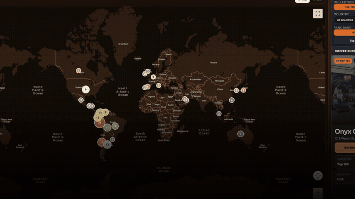

# ROAST. ☕
[](https://www.python.org/downloads/)
[](https://fastapi.tiangolo.com/)
[](https://www.uvicorn.org/)
[](https://docs.pytest.org/)
[](https://opensource.org/licenses/MIT)

### World's 100 Best Coffee Shops ☕️ Interactive Map Explorer 🗺️

## The Story

Earlier this year I visited **[Bouche](https://theworlds100bestcoffeeshops.com/)** in Brussels, Belgium and it completely changed what I thought a coffee shop could be. The beans were a house blend, but the quality was on another level. The interior, the merch, the whole vibe: "I was hooked".

That trip sent me down a rabbit hole. I discovered **[The World's 100 Best Coffee Shops](https://theworlds100bestcoffeeshops.com/)**, an annual ranking published every February at a global coffee festival. The project initially covered **Top 100 Global** and **Top 100 South America**; it now also includes **Europe** and **North, Central America and the Caribbean**. Bouche made it at #75.

I built ROAST. to make that data actually explorable. 
Whether you're on a work trip, traveling, on vacation, or just visiting someone;  
Whenever the coffee vibes hit, you can open ROAST. and instantly see if one of the world's best coffee shops is near you! Why not?!

---

> **[→ Visit ROAST. Live](https://yfc-ophey.github.io/Top-100-Best-CoffeeShops/)**

## Demo Video

[](demo/roast-brag.mp4)

Watch or download the full **[ROAST demo video](demo/roast-brag.mp4)**.

The site features:
- Interactive world map with country-level shop density bubbles
- Drill-down to individual shop details (address, city, country, rank)
- **2026** and **2025** Edition buttons: 400 current entries and 200 archived
  entries, respectively, with list and map results updating together
- Filterable list view by collection, country, and rank band
- Every shop carries an `edition_year`; past editions are archived rather than
  overwritten, so the year filter grows as new rankings are released
- Reviewed shop coordinates against their addresses and corrected the reported
  Colombia pins for Rituales Compañía de Café, Simón Coffee, and Mr Wush Wush
- Shop cities and street addresses come from their official locale pages;
  missing source fields display as "Not provided" in the list
- Public Google Maps links — no API key required for visitors
- Dataset freshness footer backed by `data/metadata.json` provenance
- Optional map-love ratings with a public nickname list, backed by the FastAPI likes endpoint

---

## What This Project Does

A zero-cost, open-source pipeline that:

1. **Scrapes** the World, South America, Europe, and North/Central America and Caribbean rankings from [theworlds100bestcoffeeshops.com](https://theworlds100bestcoffeeshops.com/)
2. **Enriches** each shop entry with city, address, and geocoordinates
3. **Generates** `JSON`, `CSV`, and `KML` artifacts
4. **Guards** against partial scrapes and geocode wipes before committing data
5. **Builds** a static site and auto-deploys via GitHub Pages
6. **Runs automatically** on a CI/CD schedule via GitHub Actions

---

## Tech Stack

| Layer | Technology |
|---|---|
| Language | Python 3.11+ |
| Preview UI | FastAPI + Jinja2 |
| Site Builder | Static HTML/CSS generator |
| Maps | Public Google Maps links (zero API cost) |
| Testing | pytest |
| CI/CD | GitHub Actions → GitHub Pages |

---

## Project Structure

```
Top-100-Best-CoffeeShops/
├── src/                  # Scraper, enricher, site builder
├── data/                 # current_list.json (source of truth)
├── output/               # coffee_shops.csv, coffee_shops.kml
├── site/                 # Generated static site (index.html + assets)
├── templates/            # Jinja2 HTML templates
├── tests/                # pytest test suite
├── docs/                 # Runbook, release timeline, case study
└── .github/workflows/    # CI/CD automation
```

---

## Zero-Cost Boundary

This project runs entirely for free:

- **Visitors** never need a Google API key — all map links are plain Google Maps URLs
- **CI** handles scraping, building, and deploying automatically
- **Optional**: Owner-only geocoding refresh via CLI (uses Google Places API once annually)

## Map Love Ratings

The main page includes a two-choice map rating prompt (❤️ or 💔) and a
`likes.html` page that lists submitted nicknames and ratings. Nicknames are
public; the service stores a random browser ID to accept one rating per browser,
and does not store email addresses or IP addresses. The map itself is static
GitHub Pages, so shared ratings require a separately hosted FastAPI service
with persistent storage.

Deploy this app as a FastAPI service with a persistent disk and run
`uvicorn src.web_app:app --host 0.0.0.0 --port $PORT`. Set `LIKES_DB_PATH` to a
file on that persistent disk and `LIKES_ALLOWED_ORIGINS` to the Pages origin
(for this repository: `https://yfc-ophey.github.io`). Then add the service's
public base URL as the GitHub Actions repository variable `LIKES_API_URL`.
The Pages workflow embeds that URL in both generated pages. Until this is
configured, the rating count and public list show that the shared service is
unavailable, and the automatic rating prompt stays closed.

---

## Running Locally

```bash
# Install dependencies
pip install -e .

# Run full pipeline (scrape → enrich → build)
python src/main.py scrape-only
python src/main.py build-site

# Preview UI
PYTHONPATH=src uvicorn src.web_app:app --reload

# Run tests
pytest
```

---

## Development Framework

Use the standardized delivery framework in:

- `docs/development-framework.md`

Use the helper command for repeatable gates:

```bash
# Verify targeted + full tests
scripts/dev-framework.sh verify

# Full pre-push gate (tests + build-site + diff review)
scripts/dev-framework.sh prepush

# Trigger deployment workflow after merge
scripts/dev-framework.sh workflow update_map.yml main
```

For operations and incident recovery, use **[docs/RUNBOOK.md](docs/RUNBOOK.md)**.
For the agentic-engineering story behind this repo, use
**[docs/case-study-agentic-engineering.md](docs/case-study-agentic-engineering.md)**.

---

## CI/CD Workflow

Every Monday (plus daily during the February release window, or manually via
`workflow_dispatch`), GitHub Actions will:

1. Run the test suite
2. Execute the scrape + build pipeline, guarded against scrape collapse and geocode wipes
3. Commit generated artifacts (including `data/metadata.json` provenance) back to the repo
4. Deploy to GitHub Pages
5. Open a reminder issue if an owner geocode refresh is needed

Operations details and failure playbooks: **[docs/RUNBOOK.md](docs/RUNBOOK.md)**.
How this repo was built with AI coding agents, isolated branches, and
verification gates: **[docs/case-study-agentic-engineering.md](docs/case-study-agentic-engineering.md)**.

---

## Known Limitations

- Source site uses Elementor — selectors may shift when the site redesigns
- Detail-page scraping is intentionally throttled (respectful crawl speed)
- Place ID completeness depends on annual owner geocode refresh

---

## Data Source

All coffee shop data sourced from **[theworlds100bestcoffeeshops.com](https://theworlds100bestcoffeeshops.com/)** — an independent annual ranking published each February.

---

*Built by [@YFC-ophey](https://github.com/YFC-ophey) · [Buy Me a Coffee](https://buymeacoffee.com/opheliachen)*


## Regional lists and shop photos

The explorer now includes the official [Europe Top 100](https://theworlds100bestcoffeeshops.com/top-100-coffee-shops-europe/)
and [North, Central America and the Caribbean Top 100](https://theworlds100bestcoffeeshops.com/top-100-coffee-shops-north/),
alongside World and South America. Use **Collection** to combine or isolate rankings;
the same shop may appear in more than one ranking, with a separate rank in each.
All four sources participate in the existing weekly refresh. Each ranking card
provides a shop-specific image. The preview credits the ranking source and, if
that image fails, can request a Google Place photo with author attribution when
the optional Maps/Places browser key is enabled. Google photo requests may incur
Places charges; the site does not cache their photo URLs.

Regional source pages use different shop URL paths. Parsing groups fields by shop
URL so an omitted country cannot absorb the next shop's rank. Missing source fields
remain blank, and directions fall back to a shop search when exact coordinates are
unavailable. New country overview positions use Google's canonical country coordinates;
these are country bubbles, not shop locations. Individual pins require verified
coordinates; shops without them remain available in the list and country view.
No paid geocoding was run for this update.
